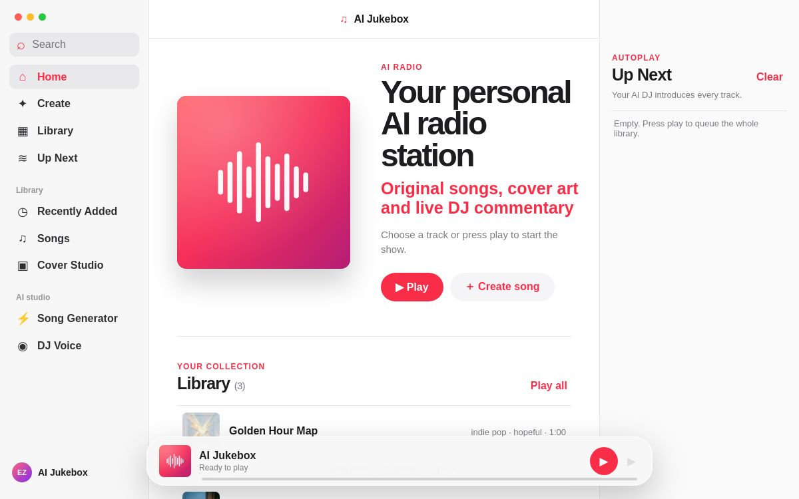
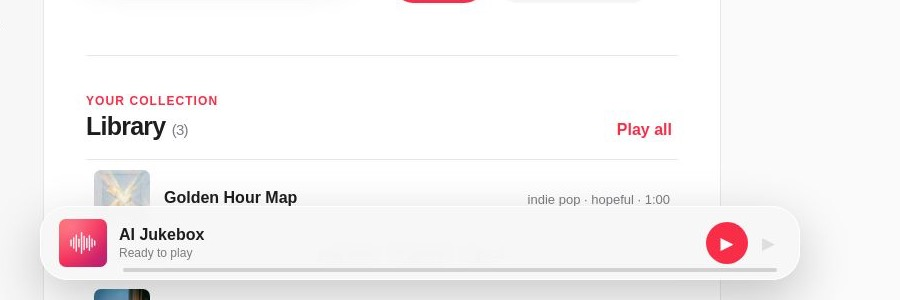

# AI Jukebox

## Three interfaces, one library

Use **Interface** in the header to choose Elias (AI Jukebox), James (Midnight Radio), or Oliver (Afterhours). Your choice is remembered in this browser. Changing designs keeps the current audio, queue, generated songs, and form values intact. All three use the same hosted library and generation services.

The integrated designs adapt the light Elias interface, James's dark green Midnight Radio palette and genre cards, and Oliver's olive/peach Afterhours palette and serif hero. They share the hosted application controls; they are not independent deployments of the original branch apps. Branch-specific backend features (including Midnight Radio autonomous sessions and Afterhours IndexedDB storage) are not part of the interface selector. Existing local libraries from those standalone apps are not automatically imported.

Integration records the original branch histories on `main`; the contributor branches remain unchanged. UI switching checks: `node --test tests/interfaces.test.mjs`.

AI Jukebox is a full-stack music application for MBAX 6418 Assignment 3. It creates original songs, matching cover art, and spoken radio-DJ transitions using only the required class services.

- Live app: https://ai-jukebox.eliaszeller2.chatgpt.site/jukebox
- Repository: https://github.com/eliaszeller/ai-jukebox
- Primary submission branch: [`main`](https://github.com/eliaszeller/ai-jukebox/tree/main)



## Core features

1. **Custom songs:** select a searchable style and mood, optionally enter an artist for broad musical inspiration, choose 15–180 seconds, and generate either a vocal or instrumental MP3. Qwen writes original lyrics and converts an artist reference into a concrete production profile covering drums, instrumentation, harmony, arrangement, texture, and dynamics; ACE-Step uses that profile to create the audio. The result remains original rather than copying a melody, lyric, recording, or voice.
2. **Matching cover art:** Qwen turns the title, style, mood, theme, and lyric excerpt into an image prompt; FLUX creates a new square cover for the track.
3. **Integrated AI DJ:** Qwen writes song-specific transitions and Chatterbox speaks them before each queued song. The player uses one audio element, so DJ speech and music cannot overlap.
4. **DJ voice cloning:** the default Chatterbox voice works without an upload. A user may upload an MP3 or WAV reference that they have permission to use, then reset to the default voice.
5. **Session library:** completed songs are stored in D1/R2, appear in the library, and may be played or queued immediately.
6. **Music-focused home dashboard:** the restored AI Radio header sits above three cards for the most-listened tracks, the creation studio, and the current queue. Listen counts are kept in the visitor's browser and update when a song begins.
7. **Reference-sound guidance:** an optional MP3 or WAV can guide the generated track's broad timbre, mixing, performance feel, and atmosphere. The file is forwarded transiently to ACE-Step and is not saved in D1, R2, or Git.



## Required class services

| Feature | Service |
|---|---|
| Lyrics, titles, cover prompts, DJ scripts | Qwen3.6-35B-A3B-AWQ-4bit |
| Cover generation | FLUX.2 klein 4B |
| Song generation | ACE-Step 1.5 XL Turbo |
| DJ speech and voice cloning | Chatterbox Multilingual V3 |

The application uses only the class-provided services and does not use paid services.

## Prerequisites

- Node.js 22.13 or newer
- npm (included with Node.js)
- Git for repository workflows
- Access to the four required class services
- One class API key
- For local development, Cloudflare Wrangler/Miniflare is installed through `npm ci`

## Secure configuration

Endpoint addresses and credentials are intentionally omitted from this public repository. Obtain the current values from the private class documentation and place them in a local `.dev.vars` file using the runtime-variable names referenced by the server code.

Create `.dev.vars` in the extracted project root. Replace every placeholder locally; never commit this file:

```dotenv
CLASS_API_KEY="<class credential>"
QWEN_BASE_URL="<class text base URL including /v1>"
QWEN_MODEL="<class text model ID>"
FLUX_BASE_URL="<class image base URL including /v1>"
FLUX_MODEL="<class image model ID>"
ACESTEP_BASE_URL="<class music base URL>"
CHATTERBOX_BASE_URL="<class speech base URL without /v1>"
CHATTERBOX_MODEL="<class speech model ID>"
```

Never commit `.dev.vars`, `.env` files, API keys, endpoint addresses, generated user files, or voice recordings. These local files are ignored by Git. For a hosted deployment, enter the values as encrypted runtime variables in the hosting environment instead of placing them in source code.

## Install and launch

From an extracted GitHub ZIP or a fresh clone:

```bash
npm ci
npm run build
node --import ./scripts/sites-env.mjs ./node_modules/wrangler/bin/wrangler.js d1 execute DB --local --config dist/server/wrangler.json --persist-to .wrangler/state --file drizzle/0000_faulty_unicorn.sql
npm start
```

Open the loopback URL printed by Wrangler and append `/jukebox`. The migration command initializes the fresh local database; do not rerun it against an existing database. Supply `.dev.vars` before starting the app. A live hosted demo is not a substitute for this ZIP installation.

For development with hot reload:

```bash
npm run dev
```

The development server normally starts on `http://127.0.0.1:5173`; open `/jukebox`.

### Local storage

The app uses the `DB` D1 binding for track metadata and the `BUCKET` R2 binding for generated MP3s, covers, DJ clips, and optional voice references. The bindings are declared in `.openai/hosting.json`. The initial schema is in `drizzle/0000_faulty_unicorn.sql` and creates `tracks` and `settings` tables.

For a local Miniflare database after building:

```bash
node --import ./scripts/sites-env.mjs ./node_modules/wrangler/bin/wrangler.js d1 execute DB --local --config dist/server/wrangler.json --persist-to .wrangler/state --file drizzle/0000_faulty_unicorn.sql
```

Run the migration only once for a fresh local state directory.

## App navigation

The interface uses separate views instead of one long scrolling page:

- **Home:** shows the AI Radio artwork and playback header, the three most-listened tracks, a shortcut to the studio, and a preview of Up Next.
- **Library:** contains every available track with play, queue, lyrics, and artwork actions.
- **Create:** contains the searchable style and mood controls, song generator, cover workflow, generation status, and DJ voice settings.
- **Up Next:** opens the queue panel used by the AI DJ sequence.

The sidebar intentionally contains only these primary destinations. Selecting a track in the Home ranking plays it immediately. The persistent bottom player remains available in every view and reports whether the DJ or a song is currently playing.

## How to exercise the required features

### 1. Generate a custom song

1. Open **Create** from the sidebar or the Home studio card.
2. Search for or type a style and mood. Optionally add an **Artist inspiration** reference and an MP3/WAV **Reference sound** that you own or have permission to use.
3. Select a duration and choose **Vocal** or **Instrumental**.
4. Optionally enter a title and theme.
5. Select **Generate song + cover**.
6. Watch **Generation status**. The finished track appears in the library; readable errors include a retry path.

### 2. Verify matching cover art

Open the completed track in the library. Its FLUX cover appears beside the track. If cover generation fails after audio succeeds, the track remains usable and **Generate cover** retries only the artwork.

The cover below was generated during the documented end-to-end test for “Evidence Sunrise.”


### 3. Use the AI DJ

1. Add two or more tracks to **Up Next**, or select **Play all**.
2. Press play.
3. The bottom player changes to **AI Jukebox — DJ Radio** while the spoken introduction plays; its progress bar advances with the speech.
4. The player then switches to the song cover and metadata. At song end, the next DJ introduction starts automatically.
5. Play/pause and skip remain available throughout the sequence.

### 4. Customize the DJ voice

Open **Create**, scroll to **DJ voice**, upload a permitted MP3 or WAV between 2 KB and 10 MB, and play the next queued track. Use reset to remove the stored reference and return to the default voice. Voice-reference files are runtime data and are never part of the repository or ZIP.

## Included sample songs

Three ready-to-play samples are committed under `public/samples/`:

| Title | Type | Style | Mood |
|---|---|---|---|
| Golden Hour Map | Vocal | Indie pop | Hopeful |
| Pencil Rain | Instrumental | Lo-fi hip-hop | Chill |
| Neon Tide | Vocal | Synthwave | Nostalgic |

They were generated in advance using the class endpoints only: Qwen created titles, themes, original lyrics, and cover prompts; ACE-Step generated the MP3s; FLUX generated the covers. Exact prompts, lyrics, model metadata, and seed values are recorded in `public/samples/manifest.json`. No third-party songs, lyrics, covers, or voice samples are bundled.

## Test evidence

See [docs/TEST_RESULTS.md](docs/TEST_RESULTS.md) for dated inputs, expected behavior, actual results, asset validation, and the failure test. See [docs/INDEPENDENT_INSTALL.md](docs/INDEPENDENT_INSTALL.md) for the clean GitHub ZIP procedure and results.

Historical core-feature checks (2026-10-21; earlier deployment, not a fresh test of every feature on current `main`):

- Hosted configuration: no missing variables
- Bundled samples: 3/3 available
- Vocal generation: passed
- AI lyrics: passed
- ACE-Step MP3: passed
- FLUX cover: passed
- Qwen + Chatterbox DJ MP3: passed
- Invalid-duration recovery: passed
- Production build: passed
- Clean GitHub ZIP install (`npm ci`): passed
- Clean GitHub ZIP production build: passed

## Design judgment

The most important design choice was using one HTML audio element for both DJ clips and songs. The queue is an explicit state machine: `dj-loading → dj → song → next track`. Testing showed that the DJ MP3 finishes before the track is loaded, eliminating overlap and keeping pause, skip, seeking, and progress behavior consistent. Prefetching the next DJ script reduces silence without playing two sources simultaneously.

The interface intentionally resembles a familiar music library rather than an “AI dashboard.” Home preserves the recognizable radio artwork and headline while providing three practical cards in a left-to-right hierarchy: Library, Create, and Up Next. Separate Home, Library, and Create views keep each task focused. Searchable style and mood controls still allow free typing, while the persistent bottom player exposes the currently active phase.

## Investigated limitation

Song generation is asynchronous at the ACE-Step service but the app’s `/api/songs` request waits for completion. A long or overloaded generation can therefore take minutes. The server polls for up to 15 minutes and returns service-specific messages for credential rejection, rate limits, generation failure, missing output, and timeout. A deeper future improvement would move generation into a durable background job so progress survives a browser or request interruption.

A second limitation is identity scope: authenticated visitors receive their own D1/R2 library, while anonymous visitors share the fallback public library. This is suitable for classroom testing but should be replaced with required authentication for a multi-user production service.

## Safeguards

- Credentials are read only from server-side runtime variables.
- Browser JavaScript never receives the class API key.
- `.dev.vars`, `.env*`, generated runtime state, archives, and local output directories are ignored.
- User uploads and voice references are stored in R2, not Git.
- The repository contains only class-generated sample assets.
- Error responses truncate upstream text and do not log credentials.

## Submission checklist

- Submit repository: https://github.com/eliaszeller/ai-jukebox
- Submit the final `main` commit ID (copy its full SHA from GitHub).
- Download the ZIP from that exact commit on GitHub, rather than a moving branch ZIP. URL format: `https://github.com/eliaszeller/ai-jukebox/archive/<full-commit-sha>.zip`.
- Confirm the ZIP contains this README, dependency lockfile, screenshots, tests, sample MP3s, and sample covers.
- Keep teammate issues, pull requests, contributions, and reviews visible in GitHub.
- Have a teammate repeat the clean-ZIP procedure and record their name/date in `docs/INDEPENDENT_INSTALL.md` before Canvas submission.

## Team verification

The repository contains the technical test evidence produced during development. The assignment additionally requires the team to verify the finished app and explain the findings in its own words. Each teammate should add their contribution and review through their own branch and a pull request; placeholder branches alone do not satisfy that requirement.
