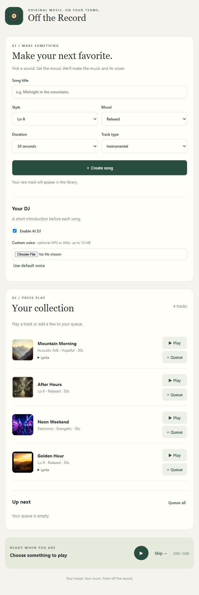
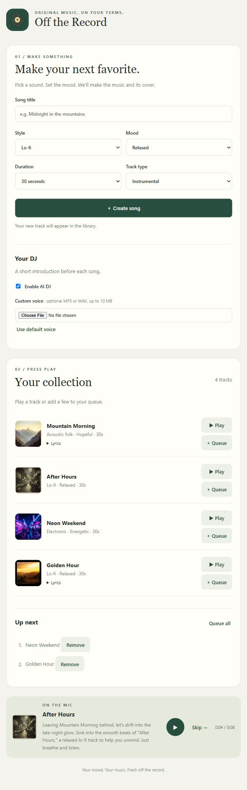

# Off the Record

A minimal local app for Assignment 3. One page, one Node.js server, no framework, database, package installation, or build step. Uses only the required class endpoints for generation. Three original sample songs and their FLUX covers are included under `samples/`.

See ASSIGNMENT_CHECK.md for the requirement-by-requirement verification and remaining group tasks.

## Run

1. Install Node.js 22.9 or newer (tested with 22.23.2).
2. Extract the project ZIP into a folder, then open a terminal in that folder.
3. Copy `.env.example` to `.env`.
4. Set `CLASS_ENDPOINTS_FILE` in `.env` to the full path of your instructor-supplied `class-endpoints.txt`. On Windows, for example: `CLASS_ENDPOINTS_FILE=C:\Users\YourName\Downloads\class-endpoints.txt`. Keep that file outside this project.
5. Run `npm start` or `node --env-file-if-exists=.env start.mjs`.
6. Open http://localhost:3000 in a browser. Stop the server with Ctrl+C.

No `npm install` is needed. Internet access to the class host is required to generate content and DJ speech; samples play without the services when AI DJ is disabled. The server binds to your computer's loopback address, not the public network. It does not host the models locally.

Alternatively, leave `CLASS_ENDPOINTS_FILE` empty and set the four `*_URL` and `*_KEY` variables in `.env`. Full request URLs are required: Qwen port 9001 `/v1/chat/completions`, FLUX port 9006 `/v1/images/generations`, ACE-Step port 9007 `/release_task`, Chatterbox port 9008 `/v1/audio/speech`. Use the class host and keys supplied by the instructor. Port 9000 is rejected. Credentials stay in server memory and are never returned to the browser. `services.json` contains non-secret model names and payload definitions checked against the service schemas.

## Use the three core features

- **Songs:** enter a title, style, mood, duration, and instrumental or vocals. Click Create song. Vocal lyrics are written by Qwen; ACE-Step generates the audio. Status updates show the current stage. Wait until the track appears. If a stage fails, correct the problem and press Create song again.
- **Covers:** each newly created track receives its own FLUX image based on the title, style, and mood. Both assets must succeed before the track enters the library.
- **DJ:** leave Enable AI DJ checked. Queue all and press Play, or play an individual track. Qwen writes a short track-specific introduction; Chatterbox speaks it before the music. An MP3 or WAV under 10 MB can be selected for a custom voice. Use default voice clears it. References are held in browser/server memory for the request and are not written to disk. Selecting a voice applies to the next introduction.
- **Playback:** Play/Pause operates on speech and music. Skip stops the current item and advances to the next queued song. Queue all appends the collection; individual Queue buttons append tracks; Remove deletes a queued entry. Playback stops at the end of the queue. A failed DJ request offers Retry DJ introduction or Continue with music; errors are never silently treated as successful DJ output.

New tracks remain accessible in the browser session, including on refresh. Cookies must be enabled. Server restart or a different browser session resets that library. Generated files remain in ignored `data/` but are not automatically restored to the library. No accounts or permanent library management are included.

## Sample provenance

All three samples were generated on October 22, 2026 through the supplied class endpoints. `samples/manifest.json` records their inputs, lyrics, and matching asset paths:

| Title | Style / mood | Type | Requested duration |
|---|---|---|---|
| Mountain Morning | Acoustic folk / hopeful | Qwen lyrics and ACE-Step vocals | 30 seconds |
| After Hours | Lo-fi / relaxed | Instrumental | 30 seconds |
| Neon Weekend | Electronic / energetic | Instrumental | 30 seconds |

FLUX generated a separate 512×512 cover using each track's title, style, and mood. No third-party songs, lyrics, artwork, or voice recordings are bundled. To regenerate missing samples, configure the environment and run `node --env-file-if-exists=.env generate-samples.mjs`. It skips titles already present in the manifest. Sample generation uses the same pipeline as the app.

## Design and investigation

One HTML audio element plays DJ speech and music in sequence. Its `ended` event switches from speech to music, then to the next queued introduction. A generation token invalidates late DJ responses after Skip or another track selection, preventing stale responses from replacing the current audio. This keeps playback logic small and makes speech/music overlap impossible within this app's player. Browser testing findings are recorded in TESTING.md.

Music generation uses ACE-Step's submit/poll/download API rather than treating the initial response as playable music. A track is published only after both music and cover succeed. This means a cover failure requires regenerating the track; retaining partial jobs would add complexity. Service queue time and DJ synthesis cause pauses between songs. There is no prefetch pipeline.

Network isolation initially prevented the development server from reaching Qwen. The UI displayed a connection error and offered retry or music-only playback. Restarting with the required network access resolved the environment restriction. Do not interpret an error screenshot as a successful end-to-end test.

## Checks and remaining team work

Run `npm test` for local automated checks. Run `node check-live.mjs` against a configured running server for service integration checks; this generates one additional session track and two speech clips. It uses a generated synthetic clip as a reference, never a person's recording. See TESTING.md for actual results and unverified behavior.

Your team must still make meaningful contributions and review one another using GitHub issues and pull requests, verify this report in your own words, and have a teammate install from the extracted ZIP using only this documentation and class credentials. This implementation does not establish that those human collaboration requirements have been completed.

Submit a shared accessible repository URL, its submitted commit ID, and a ZIP downloaded from GitHub at that same version. Include `samples/`, public files, server source, package metadata, docs, tests, and `.env.example`. Exclude `.env`, `data/`, class endpoint files, logs, uploads, voice references, and machine-specific configuration. No GitHub repository or Canvas submission is created by this app.

## API references

- ACE-Step: https://github.com/ace-step/ACE-Step-1.5/blob/main/docs/en/API.md
- FLUX live schema: http://dobolyi.com:9006/openapi.json
- Chatterbox live schema: http://dobolyi.com:9008/openapi.json

The assignment also asks for retaining and expanding its starter prompt when building in Hermes. This app was implemented in Codex; your group must follow any separate instructor requirements about the required build tool and prompt evidence.

